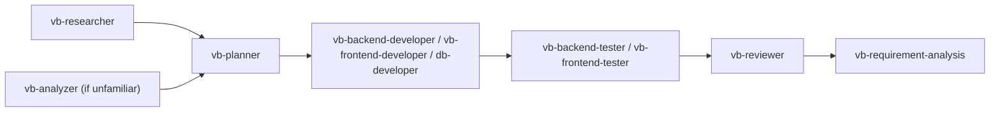

# Agent Usage Rules

When to use each subagent, in what order, and under what conditions. Agent definitions live in `<AGENTS_DIR>/`.

---

## Key Principles

1. **Agent-First**: Delegate multi-step .NET work to the specialized agent — do not handle it inline.
2. **Parallel by default**: Launch independent agents simultaneously; serialize only when one agent's output is another's input.
3. **Right agent, right scope**: Match the agent to the kind of work; do not use a general agent when a specialized one exists.
4. **One repository, two areas**: the **customer area** (`<GIT_REPO>` outside `.claude\` — the customer's program, production, customer documents; developers implement here) and the **Claude area** (`<CLAUDE_DIR>` = `.claude\` — plans, analyses, research, SQL scripts) share one git repository with one feature branch per feature. Agents take paths from `PATH.md`, write each file only in the area that owns it, and commit their own work in their own commits.

---

## Standard Workflow (Feature Development)

There are **no task files**. Phase 1 (Plan) produces the plan — its **Work Plan** (steps, owning agents, waves, dependencies, in-scope files) and **Requirement Traceability** table are the contract. Phases 2–4 (Implement → Test → Review) launch agents with a precise prompt that names the plan and their step(s); the orchestrator (`/vb-development-workflow`) tracks progress with a todo list and git history. Details: `WORKFLOWS.md` §1 and `<SKILLS_DIR>/vb-development-workflow/SKILL.md`.

Diagram — standard feature workflow chain.



---

## Documents and Diagrams

**Diagrams in documents:** every diagram, flow, sequence, ER model, state machine, or dependency graph you put in a Markdown document is written as a fenced ```mermaid block (flowchart, sequenceDiagram, erDiagram, stateDiagram-v2, classDiagram) — never ASCII art, never an image, and never a diagram without the `mermaid` language tag. Keep a one-line caption above it saying what it shows; explain it in text too, because not every viewer renders Mermaid. Tables stay tables. This applies to every agent and skill that writes a document: plans, analyses, trace reports, research reports, READMEs.

---

## Know-how Memo (`/savememo`)

Every agent and the user share one memo, `<KNOWHOW_FILE>` (`<DOC_DIR>/KNOWHOW.md`), used through `Skill: savememo`: **search it at the first error or surprise before debugging** (a solved entry may already hold the fix), and **save an entry after solving or learning something non-obvious** (symptom with exact error text, cause, fix, evidence). It is the one file every agent may edit outside its scope, only through the skill's script; no secrets; entries are marked `outdated`, never deleted. A recalled tip never overrides these rules.

---

## Analysis Mode (`/codeanalyze`)

When launched by `/codeanalyze` (no plan), `vb-analyzer`, `db-developer`, `vb-reviewer`, `vb-backend-tester`, `vb-frontend-tester`, and `vb-requirement-analysis` work **read-only on the program**: the single permitted write is their one report file `<DOC_DIR>/analysis_<solution>_<aspect>.md`, committed as `analyze:`. This overrides their usual write scope for that run: testers write no tests, the reviewer does no refactor, requirement-analysis does no refactor or traceability comments, `db-developer` connects to no database.

---

## Parallel Execution

ALWAYS use parallel agent execution for independent operations:

```markdown
# GOOD: Parallel execution
Launch agents in parallel:
1. Agent 1: vb-backend-developer — implement API and handlers
2. Agent 2: db-developer             — write the .sql migration for the same plan

# BAD: Sequential when unnecessary
First vb-backend-developer, then db-developer (when the plan already fixes the schema)
```

**Independent = safe to parallelize:**
- vb-analyzer on solution A + vb-analyzer on solution B
- vb-backend-developer + vb-frontend-developer once the API contract in the plan is fixed
- vb-backend-tester + vb-frontend-tester (different test projects)
- vb-reviewer + vb-requirement-analysis on the same finished change

**Must serialize (output → input dependency):**
- vb-planner before any developer (developers need the plan)
- Developer before its tester and before reviewers (they need the code)
- db-developer's schema before backend code that depends on a *new* table when no plan fixes it
- Any fix from a reported defect before re-running the tester that found it

---

## vb-researcher

**Use when:**
- Phase 1 of `/vb-development-workflow`, in parallel with `vb-analyzer`: libraries, APIs, known pitfalls on .NET Framework 4.8, SQL Server 2025 Express constraints, existing open-source solutions, and a **reuse decision** (port / extend / from scratch)
- Any time an error, library, API, or design question needs sourced answers

**Skip when:** the answer is already in the code, the plan, or `<KNOWHOW_FILE>`.

**Read-only — writes no file and makes no commit.** Cites a source (title, section, URL, version/date) for every claim; pins .NET Framework 4.8 / package / SQL Server versions; validates across at least two sources; never fabricates; recommends but never installs a NuGet package (the user decides).

**Output:** the sourced research report as its final message; in Phase 1 `vb-planner` embeds it in the plan's *Research* section (the plan is the only file of Phase 1).

**Called before:** `vb-planner` (the plan's *Research summary* carries the reuse decision).

---

## vb-analyzer

**Use when:**
- Starting on an unfamiliar .NET solution
- Needing the project map, NuGet dependencies, architecture pattern, EF model, or API surface before planning

**Skip when:** the structure is already known and the change is small.

**Read-only** — never modifies source files.

**Output:** `<DOC_DIR>/analysis_<solution>.md` — or, in `Mode: report-only` (Phase 1), no file: the report is its final message and `vb-planner` embeds it in the plan's *Existing Solution* section.

**Called before:** vb-planner or a developer when the codebase is unfamiliar.

---

## vb-planner

**Use when:**
- A new feature spans more than one layer (API / Application / Domain / Infrastructure / UI)
- A schema change or new endpoint is needed
- A refactor touches more than 3 files
- It is unclear which files must change

**Skip when:**
- Target files are known and fewer than 3 files change
- Fixing a single isolated bug

**Only `vb-planner` writes the plan** — the Work Plan (steps `S1…Sn`: agent, wave, depends on, requirement IDs, in-scope files, acceptance criteria) and the Requirement Traceability table. Step numbers only grow and are never reused. It does not commit a draft: the user approves the plan first (the Review Gate in `/vb-development-workflow`), then the planner is relaunched to commit it. Every other agent works on the step(s) assigned to it and reports uncovered work or plan mismatches in its final report instead of changing the plan.

**Output:** `<PLANS_DIR>/plan_<feature>.md` (PRD, architecture, API contract, schema, Work Plan, Requirement Traceability, open questions). The plan is the source of requirements for the developer, tester, and requirement-analysis agents.

---

## vb-backend-developer

**Use when:**
- Writing VB.NET business/service layer code, repositories (ADO.NET / Entity Framework 6 / Dapper), validators, domain entities
- Writing ASP.NET Web API 2 controllers (or WCF / class libraries)
- Adding EF6 mappings or migrations (only if the repo already uses EF6)
- Implementing a backend plan from vb-planner

**Requirements:**
- Confirm `<GIT_REPO>` first; read `<RULES_DIR>/ENVIRONMENT.md`
- `Option Strict On`, `Await` all I/O (never `.Result`), `ConfigureAwait(False)` in library code, DI via constructor, parameterized SQL only
- Format per `.editorconfig` and invoke `Skill: git-commit` before every commit

**Boundary with `db-developer`:** hand-written T-SQL, stored procedures, views, and `.sql` migration scripts belong to `db-developer`; EF6 code-first migrations (if used) stay here.

**Skip when:** the work is UI-only (use vb-frontend-developer) or SQL-only (use db-developer).

---

## vb-frontend-developer

**Use when:**
- Building WinForms (MVP), WPF (MVVM), ASP.NET MVC 5 (`.vbhtml`), or WebForms screens
- Implementing forms, validation, data binding, and UI state
- Implementing a frontend plan from vb-planner

**Requirements:**
- UI calls injected services only — no SQL, connections, or business rules in forms, windows, views, or code-behind
- Never block the UI thread; marshal back with `Invoke` / `Dispatcher`
- Format per `.editorconfig` and invoke `Skill: git-commit` before every commit

**Skip when:** the change is server-side only (use vb-backend-developer).

---

## db-developer

**Use when:**
- Writing T-SQL queries, stored procedures, views, indexes, or `.sql` migration scripts
- Inspecting or operating a SQL Server database via `sqlcmd`
- Tuning a slow query

**Mandatory safety rules:**
- Script first (`.sql` file in `<DB_DIR>`), then execute
- Read-only by default; confirm server, database, and impact before any write
- Explicit same-turn approval before writing to a **prod** database
- Never put passwords in files or command lines — use integrated auth or `SQLCMDPASSWORD`

**Environment:** SQL Server 2025 **Express** (no SQL Server Agent; edition limits apply); scripts must run unchanged in SSMS.

**Boundary with `vb-backend-developer`:** that agent owns EF6 mappings and code-first migrations (if used) and the data-access code; this agent owns raw T-SQL and SQL Server operations.

**SQL ownership:** when a backend feature needs a non-trivial query (report, stored procedure, view, raw SQL, performance-sensitive), the query is a separate `db-developer` step that finishes first. Its final report records a **Query Contract** (object, parameters, result columns/types, ordering, performance); the backend step depends on it, receives the contract in its launch prompt, and only wires the repository/DTO/handler. The backend never edits that SQL — a needed change goes back to `db-developer` as a fix. Simple LINQ-expressible queries need no DB step.

---

## vb-backend-tester

**Use when:**
- A backend developer (or db-developer) finishes code that needs unit or integration tests: handlers, validators, domain rules, repositories, API endpoints
- The user asks for backend test coverage

**Requirements:**
- Writes only under `<TEST_DIR>` (`.claude\test\`) — never anything in the customer area
- Reports product bugs to `vb-backend-developer` with the failing test as evidence
- Reports honest test counts from a real run (VSTest); never claims green without running
- Integration tests use a dedicated test database on SQL Server Express (connection string from an environment variable), never the dev/prod database

**Called after:** the backend implementation exists. May run in parallel with vb-frontend-tester.

---

## vb-frontend-tester

**Use when:**
- A frontend developer finishes presenters (WinForms MVP), view models (WPF MVVM), or MVC 5 controllers that need unit tests
- A critical flow needs UI automation (FlaUI for desktop, Selenium/Playwright for web) — sparingly

**Requirements:**
- Writes only under `<TEST_DIR>` (`.claude\test\`) — never anything in the customer area (forms, XAML, views, production code, solution files)
- Reports UI bugs and missing selectors to `vb-frontend-developer`
- Never calls a real API or database from a component test

**Called after:** the frontend implementation exists. May run in parallel with vb-backend-tester.

---

## vb-reviewer

**Use when:**
- After any `.vb`, `.vbhtml`, `.xaml`, `.aspx`, or `.vbproj` change
- Before merging a branch into `main`
- Cleaning up dead code or duplicate logic

**Mandatory:** must be invoked after every .NET code change — no exceptions.

**Internal order:**
1. Section 1 — Code Review (CRITICAL / HIGH / MEDIUM issues)
2. Section 2 — Refactor & Dead Code Cleanup (only when build and tests pass)

---

## vb-requirement-analysis

**Use when:**
- A developer agent finishes implementing a plan
- The user asks for a requirement-traceability audit (release or acceptance review)

**Mandatory:** runs in addition to, never instead of, `vb-reviewer`.

**Requirements:**
- Needs written requirements (`plans/plan_*.md`); stops and asks if none exist
- Walks the plan's **Requirement Traceability** table row by row and records every outcome (with `file:line` evidence) in its report
- Reviews → refactors (structure only, never behavior) → adds traceability comments
- Never patches a behavioral defect — reports it to the owning developer agent
- Never writes tests; recommends re-running the testers after any refactor

**Output:** `<DOC_DIR>/requirements_trace_<feature>.md`

**Called after:** the developer agents finish. May run in parallel with vb-reviewer.
