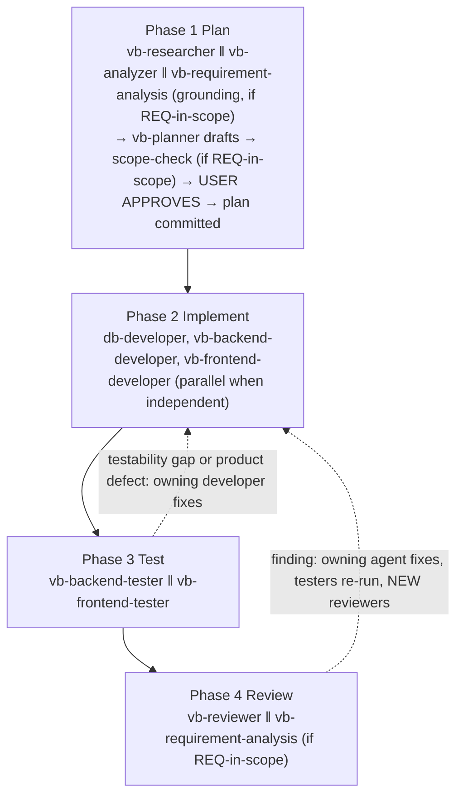
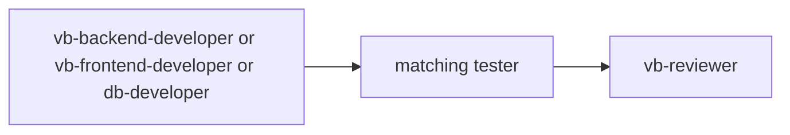
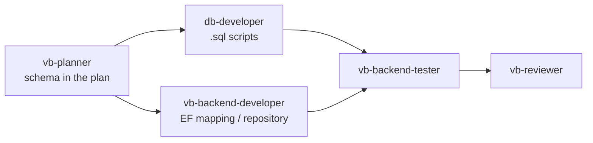
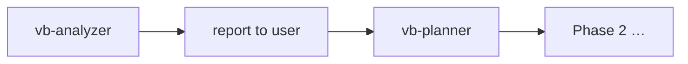
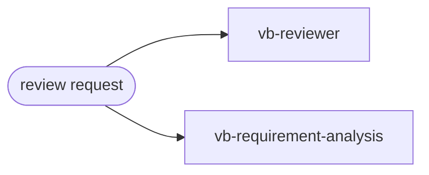
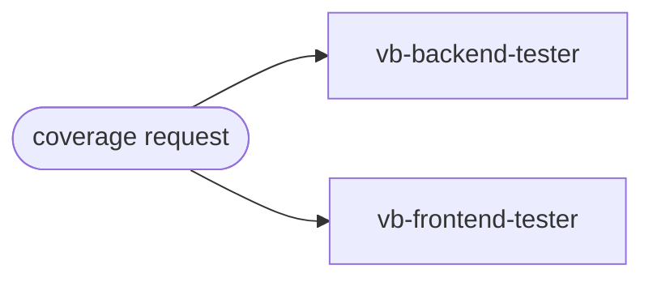
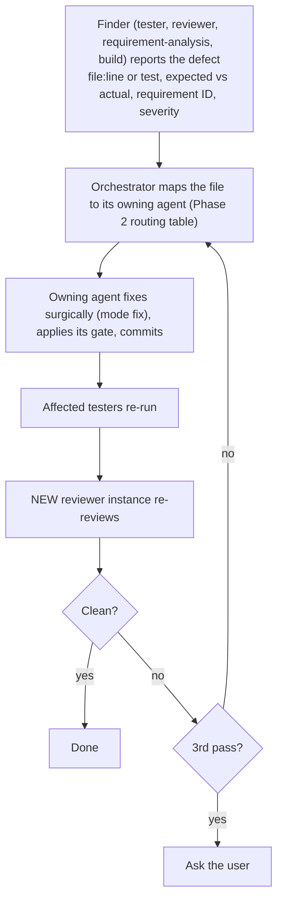

# Workflows

End-to-end sequences for common VB.NET / .NET Framework 4.8 / SQL Server Express work (stack: `ENVIRONMENT.md`). Agent roles and boundaries are defined in `AGENT.md`; this file says which agents to chain, in what order, and what each hand-off carries. The full, executable version of Section 1 is the skill `/vb-development-workflow` (`<SKILLS_DIR>/vb-development-workflow/SKILL.md`).

**There are no task files.** The contract between phases is the approved, committed plan (`<PLANS_DIR>/plan_<feature>.md`): its **Work Plan** (steps, agents, waves, dependencies, in-scope files, acceptance criteria) and its **Requirement Traceability** table. The orchestrator tracks progress with a todo list and git history.

---

## Ground Rules (all workflows)

1. **`<GIT_REPO>` comes from `PATH.md`** — agents use it without asking (unless the user or the prompt names another folder); never write into the wrong area (customer program vs `.claude\`).
2. **One feature branch for the whole feature** — code, tests, SQL scripts, plan, research, and documents all live on the same branch (`<type>/<name>`) of the single repository; never work or commit directly on `main`, `master`, `production`, `prod`, or `release*`. The `guard_main_branch.py` hook blocks commits there. **The user creates the branch; agents never create or switch branches** — if the repository is on a protected branch, stop and ask the user (`Skill: git-commit`).
3. **Commit format** — `<type>: <description>` (types: `feat`, `fix`, `perf`, `refactor`, `test`, `docs`, `chore`, and by author: `analyze` = `vb-analyzer`, `plans` = `vb-planner` (the plan file), `review1` = `vb-reviewer`, `review2` = `vb-requirement-analysis`; memo entries are `docs`) plus a `subagent: <agent-name>` line. The `validate_commit_msg.py` hook enforces the subject.
4. **The plan is the contract, the prompt is the input** — `<PLANS_DIR>/plan_<feature>.md` holds the requirements and the Work Plan; from Phase 2 on, every agent is launched with a prompt that names the plan, its step(s), its *In scope* files, and its inputs, and reads the plan sections those steps cite. Change the plan (via `vb-planner`, shown to the user again) before changing scope.
5. **Parallelize independent steps; serialize on output → input dependencies** (see `AGENT.md`).
6. **Report honestly** — build/test results are quoted from actual runs, never assumed.
7. **One history, separate commits** — each agent commits its own work; customer-area changes and Claude-area changes go in separate commits (types: rule 3). The repository holds production code and the customer's documents (read-only reference): agents never deploy, push, or merge. The final report lists the commits on the feature branch.
8. **Parallel agents share one working tree** — stage and commit only your own files by explicit path (`git add <path> …`, then `git commit -m "…" -- <path> …`); never `git add .` / `-A` / `-u`, `git commit -a` / `--amend`, `stash`, `reset`, `clean`, `pull`, `rebase`, `merge`, or branch switching during a run; retry when `.git/index.lock` exists. Steps launched together must have disjoint *In scope* files (the `guard_staging.py` hook blocks the sweeping git commands and the user-only ones — push, pull, merge, rebase, stash, reset, clean, checkout, switch, creating branches or tags).
9. **Agents never talk to the user.** A decision only the user can make ends an agent's final report with `QUESTION FOR USER: …`; the orchestrator relays it and relaunches the agent with the answer. A subagent **never writes to a prod database**.
10. **Search the memo, save the lesson** — at the first error or surprise, `/savememo search`; after solving something non-obvious, `/savememo add` (`<KNOWHOW_FILE>`).

---

## 1. New Feature (multi-layer) — Plan → Implement → Test → Review

Diagram — the four phases of a new feature, with the user's approval of the plan and the fix loops back to the owning developer.

**REQ-in-scope** = the customer's documents exist in `<CUSTOMER_DOC_DIR>`, or the user supplied written requirements. It adds `vb-requirement-analysis` to Phase 1 (grounding brief, then scope-check of the drafted plan) and to Phase 4 (traceability review). Without it, requirements come from the plan the user approved.

### Pre-flight (before Phase 1)

- `GIT_REPO` is read from `PATH.md`; if it is empty, a drive root, missing, or not a git repository, stop and ask the user (run `/config-update`).
- Check the branch (`git branch --show-current`): if it is protected (`main` / `master` / `production` / `prod` / `release*`) or detached, stop and ask the user to create the feature branch before Phase 1 — never create it yourself.
- Create a todo list covering every phase and gate; mark items done as they finish. Do not start a phase until the previous phase's gate is met.

### Phase 1 — Plan

1. **In parallel, none of them writes a file:** `vb-researcher` (research + reuse decision, as a report), `vb-analyzer` in report-only mode (only if the structure is unknown; if a current `<ANALYSIS_FILE>` exists its path is passed instead), and, when REQ-in-scope, `vb-requirement-analysis` in grounding mode (a requirement-grounding brief). Each returns its result as its final message.
2. **Draft:** `vb-planner` receives those reports pasted verbatim and writes **one file**, `<PLAN_FILE>`, with them embedded as the sections *Research*, *Existing Solution*, and *Requirement Grounding*, followed by the PRD with numbered requirements (FR / NFR / SC / API / DB), architecture, API contract or screen spec, SQL schema, Work Plan, Requirement Traceability, open questions. It does **not** commit the draft.
3. **Scope-check (REQ-in-scope):** a fresh `vb-requirement-analysis` reviews the draft against the documents (scope creep, gaps); `vb-planner` revises until no finding remains.
4. **User Review Gate:** the orchestrator presents the plan summary and waits for explicit approval. Revisions loop back to `vb-planner`. Never skipped.
5. **Commit:** after approval, `vb-planner` is relaunched to commit the plan (`plans:`).

**Gate:** the user approved the plan and the plan file is committed — one `plans:` commit carries all of Phase 1.

### Phase 2 — Implement (input: the committed Work Plan)

- Route each step by its layer: schema / `.sql` / procedure / view / non-trivial query → `db-developer`; services, repositories, EF6, Web API, WCF, class libraries → `vb-backend-developer`; WinForms / WPF / MVC 5 / WebForms → `vb-frontend-developer`. A step that fits none is a question for the user.
- Independent steps with disjoint *In scope* files run in parallel (one message, one Agent call each); a step with a *Depends on* waits for the dependency's commit. A `db-developer` Query Contract finishes first and its contract is passed to the backend step.
- Each agent applies its own gate (format, XML docs, build, `git-commit`) and commits its own work; the orchestrator confirms from the final report and `git log`, and checks the commits touch only *In scope* files. An incomplete agent is relaunched at most twice, then the user is asked.

**Gate:** every launched agent committed, and the MSBuild build passes (see `ENVIRONMENT.md`).

### Phase 3 — Test (input: Phase 2's committed files)

- `vb-backend-tester` (backend / SQL work) and `vb-frontend-tester` (UI work), in parallel, launched with the specific files and classes committed in Phase 2. They write only under `<TEST_DIR>` and never edit production code.
- A testability gap or a product defect found by a test goes to the Phase 2 agent that owns the file (a surgical `fix` launch), then the same tester re-runs. "Nothing testable here" is a valid result when reported with the reason.

**Gate:** every launched tester committed, with real test counts; no open gap or failing test.

### Phase 4 — Review (input: the changes of Phases 2–3)

- `vb-reviewer` and, when REQ-in-scope, `vb-requirement-analysis` (traceability against the plan's Requirement Traceability table), in parallel.
- Findings (CRITICAL/HIGH from the reviewer; behavioral non-conformance from requirement-analysis) are grouped by the agent that owns the file and sent back as surgical fixes; the affected testers re-run; **new** reviewer instances re-review — an agent never verifies its own fix. At most 3 review passes, then the user decides.
- Reviewers' own structural refactors (MEDIUM/LOW) must be followed by re-running the testers that cover the touched code.

**Gate:** reviewer verdict recorded, no CRITICAL/HIGH finding and no unresolved behavioral defect, every fix committed.

### Finish

Run the Section 8 checklist and give the user a final report: steps and agents, the commits on the feature branch, real build/test numbers, the reviewer's verdict, requirement coverage (REQ-in-scope), items that could not be verified from the command line. Do not merge, push, or open a PR unless the user asks.

**Skills:** `/vb-development-workflow <feature>` runs Phases 1–4 and the finish; `/vb-development-workflow --resume <feature-name>` continues an interrupted run from the plan and git history; `/codeanalyze` analyzes the existing program; `/savememo` keeps and recalls know-how; `/config-update` sets up a new computer.

**Limits:** an incomplete agent is relaunched at most twice; a review loop runs at most 3 passes; at a limit, ask the user.

---

## 2. Small Change or Single Bug Fix

Skip the planner when target files are known and fewer than 3 files change. Launch the matching developer directly with a precise prompt.

Diagram — small change or single bug fix (no planner).

- Reproduce the bug with a failing test first when practical (the tester writes it; the developer fixes the code).
- `vb-requirement-analysis` is optional here unless the fix changes behavior a requirement defines.

---

## 3. Database Change

Diagram — database change: schema in the plan, SQL and EF mapping in parallel, then tests and review.

- **Script first, run second** — the `.sql` file is committed before it is executed.
- Order of operations on a real database: dev → test → prod, each with explicit confirmation of server and database; **prod needs same-turn approval**, and a subagent never writes to prod (the orchestrator runs the reviewed script after the user's approval).
- EF6 code-first migrations (only if the repo uses them) belong to `vb-backend-developer`; hand-written T-SQL, procedures, views, and `sqlcmd` operations belong to `db-developer`. State which side a change is on.
- Never edit a migration that has already been applied — add a new one with its reverse script.
- SQL-Server-specific behavior (procedures, collation, raw SQL) is tested against a dedicated **test database on SQL Server Express** (connection string from an environment variable) — never the dev/prod database.
- Scripts must run unchanged in SSMS; there is no SQL Server Agent on Express.

**When the backend needs a non-trivial query** (report, procedure, view, raw SQL):

| Wave | Step | Agent | Depends on |
|------|------|-------|------------|
| 1 | Write, tune, and test the `.sql`; report the **Query Contract** | `db-developer` | — |
| 2 | Repository method + DTO mapping + handler using the contract | `vb-backend-developer` | wave 1 |
| 3 | Integration test against the SQL Server Express test database | `vb-backend-tester` | waves 1–2 |

- The backend never edits the SQL; a needed change goes back to `db-developer` as a fix launch, and the backend step is re-run afterwards.
- Simple LINQ-expressible queries skip the DB step and stay in the backend step.
- Deploying to a real database is a `db-developer` step (server/database confirmed; prod needs same-turn user approval); backend steps never run DDL.

---

## 4. Unfamiliar Codebase

`/codeanalyze` runs this whole section: `vb-analyzer` first, then `db-developer`, `vb-reviewer`, `vb-backend-tester`, `vb-frontend-tester` (and `vb-requirement-analysis` when the customer's documents exist) in parallel in analysis-only mode, then a `vb-analyzer` summary. The program and the tests are not touched; the only writes are report files in `<DOC_DIR>`.

Diagram — unfamiliar codebase: analyze first, report, then plan.

- `vb-analyzer` is read-only; its report goes to `<DOC_DIR>/`.
- Use the analyzer's "Before You Start" and "Potential Issues" sections as planner input.
- Several solutions can be analyzed in parallel.

---

## 5. Review and Requirement Audit (no new code)

Diagram — review and requirement audit run in parallel.

- Use before a release, before merging a long-lived branch, or on request.
- `vb-requirement-analysis` needs written requirements (the customer's documents or a plan); if none exist, run `vb-planner` to capture them first.
- Behavioral defects found go to the owning developer agent; they are **not** patched by the reviewers.
- After any structural refactor by a reviewer, re-run the testers.

---

## 6. Test-Only Work (add coverage)

Diagram — test-only work: both testers in parallel.

- Testers write only under `<TEST_DIR>` (`.claude\test\`) and never touch the customer area. If code is not testable as written (missing seam, no stable selector), they report the needed change to the orchestrator, who routes it to the developer agent, rather than editing production code.
- Run only the relevant slice while iterating (`--filter "Category=Backend"` / `"Category=Frontend"`); run the full suite before commit.

---

## 7. Defect Hand-off Loop

When a tester, reviewer, requirement-analysis, or the build finds a product defect, the finder **reports it** (it does not fix it, and no tracking file is created). The orchestrator routes it:

Diagram — defect hand-off loop: the finder reports, the owning developer fixes, a fresh agent re-verifies.

- The finder never weakens an assertion or patches production code to make the problem disappear.
- Independent fixes for different agents launch in parallel; serialize when one fix depends on another (for example a Query Contract change the backend must follow).
- A fix that touches code a tester already covered always triggers that tester again before the re-review.
- If the plan itself is wrong or incomplete, it is a **plan change**: only while no agent is running, made by `vb-planner`, shown to the user again (Review Gate), committed as `plans:`; the orchestrator then re-runs the affected steps.
- Re-run only the agents whose scope the fix touched; do not skip the re-run.

---

## 8. Commit and Merge Checklist

1. MSBuild build passes; test results (VSTest) reported with real counts.
2. Formatting follows `.editorconfig` (`dotnet format` only for SDK-style projects).
3. On a feature branch; commit follows `<type>: <description>` + `subagent:` line.
4. Reviewer verdict recorded; unresolved findings listed in the commit body or the PR description.
5. `.sql` scripts in `<DB_DIR>` committed; no passwords, connection strings, logs, or exports staged.
6. The plan (research and analysis are inside it) and the trace report (`<PLANS_DIR>`, `<DOC_DIR>`) are committed on the feature branch with the change (`plans:` / `review2:` by document kind).
