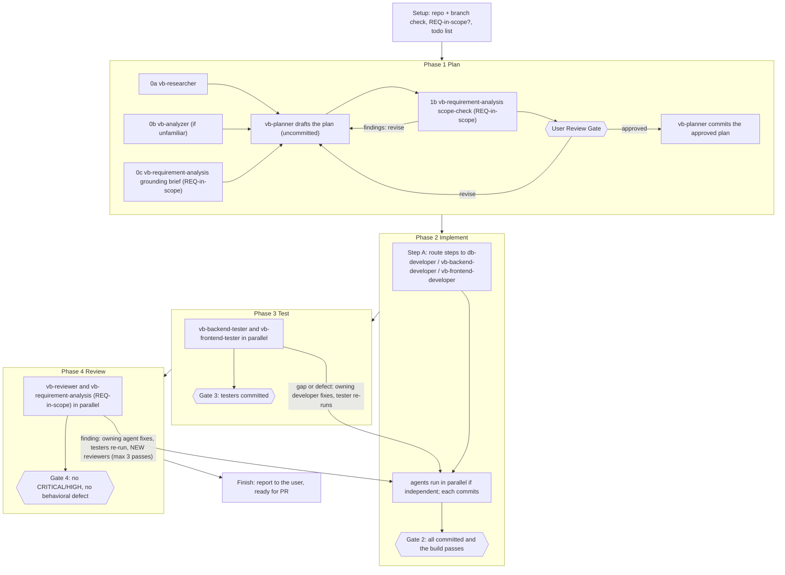

## When to Use

- Starting a new feature, screen, API endpoint, database change, or refactor end-to-end
- Any work that needs planning before coding, testing after coding, and review after that
- The user invokes `/vb-development-workflow <feature description>` (or `/vb-development-workflow --resume <feature-name>` after an interruption)

**Skip when:** the change is a single known file or an isolated bug (launch the matching developer agent directly, then its tester and `vb-reviewer`), or only an analysis is wanted (`/codeanalyze`), or only a review (`/code-review`-style audit with `vb-reviewer`).

---

## Hard Rules

1. **The main session is the orchestrator and never does a phase's work inline.** It launches agents, relays questions, runs the gate checks (build, `git log`), and reports. It writes no application code, tests, SQL, plan, research, or analysis itself (`CLAUDE.md` → Standing Orders).
2. **No task files, no task folders.** The contract is `<PLANS_DIR>/plan_<feature-name>.md` — specifically its **Work Plan** table (steps `S1…Sn`: agent, wave, depends on, requirement IDs, *In scope* files, acceptance criteria). Every agent is launched with a precise prompt (template below). Progress lives in the todo list and in git history (`git log --grep "subagent:"`).
3. **Paths come from `PATH.md`** (`<GIT_REPO>`, `<PLANS_DIR>`, `<DOC_DIR>`, `<DB_DIR>`, `<TEST_DIR>`, `<CUSTOMER_DOC_DIR>`). Stack: `ENVIRONMENT.md`.
4. **Each phase's gate must pass before the next phase starts.** Do not skip a gate for a small feature.
5. **The user creates the feature branch.** On `main` / `master` / `production` / `prod` / `release*` (or a detached HEAD) stop and ask the user to create it; never create or switch branches, never push, merge, or deploy.
6. **Each agent applies its own gate (format, XML docs, build, `git-commit`) and commits its own work** by explicit path. The orchestrator confirms it happened; it does not re-run those gates on the agent's behalf.
7. **Parallel agents share one working tree:** agents launched together must have **disjoint *In scope* files** (the plan guarantees it; the orchestrator re-checks before a parallel launch and serializes any overlap).
8. **Agents cannot talk to the user.** An agent that needs a decision ends with `QUESTION FOR USER: …`; the orchestrator relays it and relaunches (or resumes) the agent with the answer in the prompt. A subagent **never writes to a prod database** (see "Questions, blocks, and prod databases").
9. **Defects are fixed by the owning agent, surgically, then re-verified by a fresh agent instance.** An agent never verifies its own fix.

---

## Agent Launch Prompt (template)

Every launch passes this, and only this:

```
Feature: <feature-name>
Plan: <PLANS_DIR>/plan_<feature-name>.md  — your step(s): <S2[, S3]>   (read the sections they cite)
Mode: implement | fix | test | review | report-only (Phase 1 research/analysis: write no file, return the report)
In scope (the only files you may change): <list from the Work Plan>
Inputs from earlier steps: <report paths / commit subjects / Query Contract text>
Findings to fix (mode=fix only): <id, file:line, expected vs actual, requirement ID, severity>
User decisions so far: <answers to earlier QUESTION FOR USER, or "none">
Reply with your final report in the format of your "Work Assignment" section.
```

---

## Pre-execution Setup (mandatory — before Phase 1)

### A — Repository and branch

1. Read `PATH.md`. If `<GIT_REPO>` is empty, a drive root, missing, or not a git repository, stop and ask the user (`/config-update`).
2. `git branch --show-current`. Protected branch or detached HEAD → stop and ask the user to create the feature branch (for example `feat/<feature-name>`). Do not continue until it exists.
3. Derive `<feature-name>`: a short kebab-case slug of the request. If `<PLANS_DIR>/plan_<feature-name>.md` already exists, ask the user: **resume / extend that plan** (`--resume` flow, below) or **use a new name**. Never overwrite a plan.

### B — Detect REQ-in-scope

Mark the run **REQ-in-scope** when `<CUSTOMER_DOC_DIR>` contains documents (specifications, requirements, manuals) or the user supplied written requirements for this feature in `$ARGUMENTS`. REQ-in-scope adds `vb-requirement-analysis` to Phase 1 (grounding brief and plan scope-check) and to Phase 4 (traceability review, in parallel with `vb-reviewer`). Phases 2 and 3 are unaffected. If neither source exists, `vb-requirement-analysis` is not launched; requirements then come only from the plan, which the user approved.

### C — Todo list

Create a todo list covering every phase and gate, and mark each item done as it finishes. **Do not proceed to the next phase until the current phase's GATE item is checked.**

```
[ ] Phase 1 — Plan
    [ ] 0a: vb-researcher report received (research + reuse decision)   — parallel with 0b/0c, writes no file
    [ ] 0b: vb-analyzer report received in report-only mode (skip if a current analysis exists)
    [ ] 0c (REQ-in-scope only): vb-requirement-analysis grounding brief complete
    [ ] 1: plan file exists at <PLANS_DIR>/plan_<feature-name>.md with Research / Existing Solution / Requirement Grounding embedded (drafted by vb-planner, NOT yet committed)
    [ ] 1b (REQ-in-scope only): vb-requirement-analysis scope-check of the drafted plan complete, findings resolved
    [ ] GATE: user reviewed and approved the plan  ← before any commit
    [ ] GATE: plan committed  ← before Phase 2
[ ] Phase 2 — Implement
    [ ] Step A: each Work Plan step routed to its agent; dependencies read from the plan
    [ ] each routed agent complete AND committed (one checkbox per agent)
    [ ] GATE: implementation committed and the build passes  ← before Phase 3
[ ] Phase 3 — Test
    [ ] vb-backend-tester launched (if backend/SQL work exists) — complete or "nothing testable"
    [ ] vb-frontend-tester launched in parallel (if UI work exists) — complete or "nothing testable"
    [ ] testability gaps / product defects routed to the owning Phase 2 agent, tester re-run
    [ ] GATE: every tester committed (test files + report)  ← before Phase 4
[ ] Phase 4 — Review
    [ ] vb-reviewer pass 1 complete
    [ ] (REQ-in-scope only) vb-requirement-analysis pass 1 complete, in parallel
    [ ] findings grouped by owning agent, fixes launched and committed
    [ ] affected testers re-run, then NEW reviewer(s) re-review (loop ≤ 3 passes, then ask the user)
    [ ] GATE: no CRITICAL/HIGH and no unresolved behavioral defect
[ ] Finish — final report to the user
```

---

## Phase 1 — Plan

**Must complete before Phase 2 starts.**

1. **Launch in parallel (one message, one Agent call each):**
   - **0a `vb-researcher`** — the research question(s) derived from the request: libraries/APIs involved, known pitfalls on .NET Framework 4.8, SQL Server 2025 Express constraints, existing open-source solutions and a **reuse decision** (port / extend / from scratch). It writes no file: the sourced report is its final message.
   - **0b `vb-analyzer`** in `Mode: report-only` — only if the structure of `<GIT_REPO>` is unknown (no current `<DOC_DIR>/analysis_<solution>.md`; if one exists, pass its path instead). It writes no file and makes no commit: the report is its final message.
   - **0c (REQ-in-scope only) `vb-requirement-analysis`** in *grounding mode* — reads the customer's documents and produces a **requirement-grounding brief** in its final message: which requirements (with document and section) apply to this feature, and what is explicitly out of scope per those documents. It writes no code and no file.
2. **Draft the plan** — after 0a–0c return, launch `vb-planner` with the request and the reports returned by 0a–0c **pasted verbatim** into the prompt (research report, existing-solution report or analysis path, grounding brief) as explicit inputs. It writes the **single file of Phase 1**, `<PLANS_DIR>/plan_<feature-name>.md`: the reports embedded as the sections *Research*, *Existing Solution*, and *Requirement Grounding*, then the PRD with numbered requirements, architecture, API contract / screen spec, SQL schema, **Work Plan**, **Requirement Traceability**, risks — and **does not commit yet**. No research or analysis file is created. When REQ-in-scope, the plan's scope must trace to a requirement in the brief; anything else is a scope question for the user, not something to plan around silently.
3. **Scope-check gate (REQ-in-scope only)** — launch `vb-requirement-analysis` again (fresh instance) to review the drafted plan against the same documents. It reports any planned item that does not trace to a requirement (scope creep) and any requirement the plan should cover but does not (gap). If it finds either, relaunch `vb-planner` to revise; repeat until no open finding remains.
4. **Questions** — `vb-planner` or `vb-researcher` may end with `QUESTION FOR USER`: relay it, then relaunch with the answer.

**Output:** `<PLANS_DIR>/plan_<feature-name>.md` — the only file of Phase 1.

### Mandatory: User Review Gate (before every commit and before Phase 2)

**Applies whether or not REQ-in-scope.** Once the plan is final (REQ-in-scope: after the scope-check resolves), stop and present it before doing anything else — do not commit yet:

```
Plan ready for review: <PLANS_DIR>/plan_<feature-name>.md

Summary:
  - Feature: <name>
  - Layer(s): <db / backend / frontend, from the Work Plan>
  - Reuse decision: <port / extend / from scratch, from the research report>
  - Key architecture points: <2-4 bullets>
  - Steps: <S1…Sn with agent and wave>
  - (REQ-in-scope only) Requirements grounding this plan: <IDs / document sections>
  - Open questions / assumptions: <list or "none">

Proceed to commit this plan and start Phase 2 (Implement)? [Y] Yes  [N] Revise first
```

- **Approved:** relaunch `vb-planner` with the single instruction *"commit the approved plan"* (it uses `Skill: git-commit`, type `plans:`), then confirm the commit with `git log`.
- **Changes requested:** send the feedback to `vb-planner` to revise, re-present the updated summary, loop until approved. Do not reinterpret vague feedback; ask a clarifying question instead.
- **Never skip this gate** — not for a small feature, not because the plan "looks obviously fine."

**STOP — do not proceed to Phase 2 until (a) the user approved the plan and (b) the plan file is committed.** If the commit fails, stop and ask the user how to proceed.

---

## Phase 2 — Implement

**Starts only after Phase 1 is complete. Input: the committed plan's Work Plan.**

### Step A — Route each step to its agent

| Step's layer (from the Work Plan) | Launch |
|---|---|
| Schema, `.sql` migration, stored procedure, view, index, non-trivial query (with its **Query Contract**) | `db-developer` |
| Business/service layer, repositories, EF6 mappings, Web API 2 controllers, WCF, class libraries, DI registration | `vb-backend-developer` |
| WinForms, WPF, ASP.NET MVC 5 (`.vbhtml`), WebForms screens, validation, binding, UI state | `vb-frontend-developer` |
| Anything not covered above | Ask the user (no catch-all developer exists) |

**A real plan commonly spans more than one row** — for example a new table (`db-developer`), a service that reads it (`vb-backend-developer`), and a screen (`vb-frontend-developer`). Read the dependencies from the Work Plan's *Depends on* column and apply the standard parallel-execution rule (`.claude/rules/AGENT.md`):

- **Independent agents → launch in parallel**, one message with one Agent call per agent, when neither's output is an input of the other's and their *In scope* files are disjoint
- **Dependent agents → serialize**: launch the dependency first and wait for its commit. In particular a `db-developer` step with a **Query Contract** finishes first; its final report carries the contract, which you pass to the backend step as an input
- **Never let one agent absorb another's territory.** If a boundary is ambiguous, check the row each piece of work matches; a file two steps need is owned by one step and the other waits (a legacy `.vbproj`, `Global.asax.vb`, DI module, `Web.config`)

### Step B — Launch

Launch each routed agent with the **Agent Launch Prompt** (mode `implement`). The agent reads the plan, implements its step(s), applies its own gate, commits, and ends with its final report.

### Step C — Confirm each agent's gate

Every developer agent already applies its own gate (format per `.editorconfig`, XML docs, build, `Skill: git-commit`) and commits its own work as the last step of its instructions. **This workflow confirms that it happened; it does not perform the gate a second time.** For each agent verify, from its final report and git:

- Status is `done` with real build output quoted, and its acceptance criteria are met
- Its commit(s) exist (`git log --grep "subagent: <name>"` since the plan commit) and touch **only files in its *In scope*** (`git show --stat`); a commit outside scope is a defect to fix, reported to the user
- No uncommitted leftovers of that agent (`git status --porcelain`)

When several agents ran, confirm **each one individually** before treating Phase 2 as done. An incomplete agent is relaunched **at most twice**; after that, ask the user.

### Gate 2

Every launched agent has committed, and the solution **builds** with MSBuild (commands in `ENVIRONMENT.md`; report real output). A build error is mapped to the owning agent by file (Step A table) and sent back as a `fix` launch; re-run the build. **STOP — do not proceed to Phase 3 until the build passes.**

---

## Phase 3 — Test

**Starts only after Phase 2 is complete (every routed agent committed). Input: Phase 2's committed files.**

Launch the testers with the specific files/classes Phase 2 committed — not a vague "test everything":

- `vb-backend-tester` — when backend or SQL work exists (services, validators, repositories, Web API endpoints; integration tests against a dedicated SQL Server Express test database)
- `vb-frontend-tester` — when UI work exists (presenters, view models, MVC controllers; UI automation only for critical flows)

They run **in parallel** (different test projects under `<TEST_DIR>`). Each writes only under `<TEST_DIR>` (`.claude\test\`), reports honest counts from a real VSTest run, and commits its own tests and report. Testers never edit production code.

### Not every Phase 2 output is testable

A step may have no seam or no logic worth a test (a mapping file, a script). A tester reporting "nothing testable here, because …" is a valid outcome, not a failure.

### If a tester reports a testability gap or a product defect

- **Testability gap** (no seam, `New` inside a method, no stable selector): route it to the Phase 2 agent that owns the file (Step A), as a surgical `fix` launch that adds the seam; then re-run the same tester. Testers never restructure production code.
- **Product defect** (a test fails because the code is wrong): same routing — the owning developer fixes it (mode `fix`, with the failing test name, expected vs actual, requirement ID), then the tester re-runs. Never weaken an assertion to make a failure disappear.

**Gate 3 — STOP until every launched tester has committed** (tests + report), with real test counts. "Nothing testable" and "all tests pass" are both valid; an unresolved gap or failing test is not — loop back to Phase 2 first.

---

## Phase 4 — Review

**Starts only after Phase 3 is complete.**

Launch **in parallel**:

- `vb-reviewer` — reviews the files changed in Phases 2–3 (`git diff <plan-commit>..HEAD -- . ':(exclude).claude'` plus the test code): CRITICAL / HIGH / MEDIUM findings, build, verdict. Its own structural refactors (MEDIUM/LOW) are allowed only when build and tests pass and must be followed by re-running the affected testers.
- (REQ-in-scope only) `vb-requirement-analysis` — requirement traceability: walks the plan's **Requirement Traceability** table row by row against the code and tests, with the customer's documents as reference; writes `<DOC_DIR>/requirements_trace_<feature-name>.md`; reports behavioral non-conformance, never patches it.

### If review finds issues — back to Phase 2, assigned to the agent that owns the file

Two finding sources feed this and route the same way: the reviewer's CRITICAL/HIGH issues, and requirement-analysis's behavioral defects. **Do not send every fix to one agent.** Use Phase 2's own Step A table:

1. Group the findings by the agent whose file(s) they are in (`db-developer`, `vb-backend-developer`, `vb-frontend-developer`; test-code findings go to the owning tester)
2. Launch each owning agent in mode `fix` with the specific findings in its files — a **surgical fix** for what was reported, not a redesign or an excuse to change unrelated code
3. Independent agents' fixes launch in parallel; serialize only when one fix depends on another (for example a `db-developer` Query Contract change that the backend must follow)
4. Each agent applies its own gate and commits its own fix (confirmed as in Phase 2 Step C)
5. **If a fix touches code Phase 3 already tested, re-run the affected tester(s)** before re-reviewing
6. **Launch the reviewer(s) again as NEW instances** — whichever agent applied a fix must not verify its own work
7. Repeat until no CRITICAL/HIGH finding and no unresolved behavioral defect remains. **At most 3 review passes**; if findings remain after the third, stop and report them to the user, who decides whether to continue

**Gate 4:** reviewer verdict recorded, no CRITICAL/HIGH finding, no unresolved behavioral defect, every fix committed.

### If review passes

The reviewers' own commits (`review1:` for reviewer changes, `review2:` for the trace report) are confirmed, not redone.

---

## Finish

- Run the commit and merge checklist (`WORKFLOWS.md` §8) and give the user a final report: the steps and their agents, the commits on the feature branch (from `git log`), real build and test numbers, the reviewer's verdict, requirement coverage (REQ-in-scope), items that could not be verified from the command line, and open questions.
- **Do not merge, push, or open a PR** unless the user asks.

---

## Questions, blocks, and prod databases

- An agent that needs a decision, or cannot proceed, ends its final report with `Status: blocked` and `QUESTION FOR USER: <question and the options it sees>` (new NuGet package, missing server/database, unclear scope, a plan that contradicts the code, any write to a **prod** database). The orchestrator relays the question to the user verbatim, then relaunches the agent with the answer under *User decisions so far*. The orchestrator never answers for the user.
- A plan mismatch found during Phases 2–4 (the plan is wrong or incomplete) goes back to `vb-planner` for a **plan change** — only while no other agent is running; the plan revision is shown to the user again (Review Gate) and committed as `plans:`; then the affected steps are relaunched.
- **A subagent never writes to a prod database.** `db-developer` delivers the reviewed script (and read-only checks) in `<DB_DIR>` and ends with the `QUESTION FOR USER`. Only after the user's **explicit approval in that same turn** does the orchestrator run the script in the main session, record the output, and relaunch (or continue) the flow.
- Limits: an incomplete agent is relaunched at most twice; a review loop runs at most 3 passes; at a limit, ask the user.

---

## Resuming an interrupted run (`--resume <feature-name>`)

There are no task files; the state is the plan plus git. On resume:

1. Confirm no agent is still running; check the branch (Setup A)
2. Read `<PLANS_DIR>/plan_<feature-name>.md`. Not committed → Phase 1 was not finished: show the plan and go to the Review Gate
3. Plan committed: list the commits since it (`git log <plan-commit>..HEAD --format="%h %s%n%b" --grep "subagent:"`), `git status --porcelain` for uncommitted work, and map each Work Plan step to done / partial / not started by its *In scope* files and commits
4. Show the user the reconstructed status and the phase you propose to resume at; start only after they agree. Partial work of an agent is finished by relaunching that agent in mode `implement` with the list of files already changed and the instruction to continue from there, not to start over

---

## Execution Order

Diagram — the workflow with its gates, the REQ-in-scope branch, and the fix loops.



---

## Key Principles

1. **Sequential phases, parallel inside a phase** — Phase 2 needs Phase 1's committed plan, Phase 3 needs Phase 2's committed code, Phase 4 needs Phase 3's results; inside a phase, independent agents run together
2. **Agent-first** — every phase delegates to its own agents; never implement, test, research, or review inline
3. **Route before you launch** — Phase 2 resolves each step to a specific agent (Step A) before launching anything; the same table routes every later fix
4. **The plan is the contract** — the approved, committed plan replaces task files; change it only through `vb-planner` and show the user the revision
5. **Single REQ-in-scope decision** — detected once in Setup B; it governs `vb-requirement-analysis` in Phases 1 and 4 only
6. **Grounding, not just auditing** — requirement analysis runs before and during planning (when documents exist) so scope problems are caught before any code exists
7. **Test before review, always** — Phase 3 runs before Phase 4; "nothing testable" is valid, an unresolved gap is not
8. **Review loop routes back through Step A** — fixes go to the agent that owns the file, affected testers re-run, and fresh reviewers re-review
9. **Each agent owns its gate** — format, build, `git-commit`; the orchestrator confirms, never repeats
10. **The user approves the plan before it is committed** — Phase 1 always stops for explicit approval; revisions loop back to `vb-planner`
11. **Questions go through the orchestrator** — agents never guess, never assume approval, and never write to a prod database
